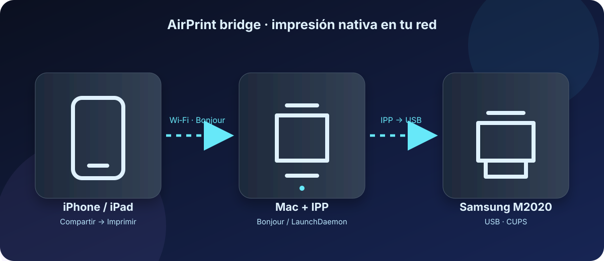

# 🖨️ macOS IPP / Bonjour Printer Bridge

Convierte una impresora CUPS —incluidas impresoras USB— en una impresora compartida por IPP/Bonjour para que un iPhone o iPad de la misma red pueda encontrarla desde **Compartir → Imprimir**. ✨



> 💡 El Mac actúa como puente: recibe el trabajo por Wi‑Fi y lo reenvía a la impresora por USB.

El Mac debe permanecer encendido y en la misma red local. Esto no convierte la impresora en un dispositivo AirPrint certificado; la compatibilidad final depende de iOS y del controlador CUPS.

## 🚀 Instalación

Revisa el script antes de ejecutarlo:

```bash
git clone https://github.com/r03r/mac-printer-bridge.git
cd mac-printer-bridge
sudo ./install.sh
```

El instalador detecta las colas CUPS, permite elegir una si hay varias y crea un LaunchDaemon en `/Library/LaunchDaemons`.

### ✅ Requisitos

- macOS con CUPS y Bonjour.
- Impresora añadida y funcional en **Ajustes del Sistema → Impresoras y escáneres**.
- iPhone/iPad y Mac en la misma Wi‑Fi; evita redes de invitados o aislamiento de clientes.
- Mac encendido y conectado a la red.

## 🧹 Desinstalación

```bash
sudo ./uninstall.sh M2020
```

## 🔎 Diagnóstico

```bash
lpstat -p -d
dns-sd -B _ipp._tcp local.
```

Las redes de invitados, el aislamiento de clientes y una VPN pueden impedir Bonjour.

### 🧪 Prueba rápida

```bash
lpstat -p -d
dns-sd -B _ipp._tcp local.
curl -I http://PrinterBridge-M2020.local:631/printers/M2020
```

En el iPhone: abre una foto o PDF → **Compartir** → **Imprimir** → selecciona la impresora anunciada.

> ⚠️ Este proyecto anuncia una cola IPP compartida; no modifica el firmware ni convierte una impresora USB en hardware AirPrint certificado. La experiencia puede variar según el modelo y la versión de iOS.

## 🍺 Homebrew

La fórmula de `Formula/mac-printer-bridge.rb` está preparada para un tap propio. Para publicarla como fórmula estable, crea primero una release/tag y actualiza el `url` y el `sha256` de esa release.

## 🛡️ Seguridad y privacidad

El instalador usa `--remote-any` para permitir que los dispositivos de la red lleguen al servicio IPP. Úsalo solo en una red de confianza. El puente no sube documentos a Internet: los trabajos permanecen entre el iPhone, el Mac y la impresora.

## 📄 Licencia

MIT. Consulta [LICENSE](LICENSE).
